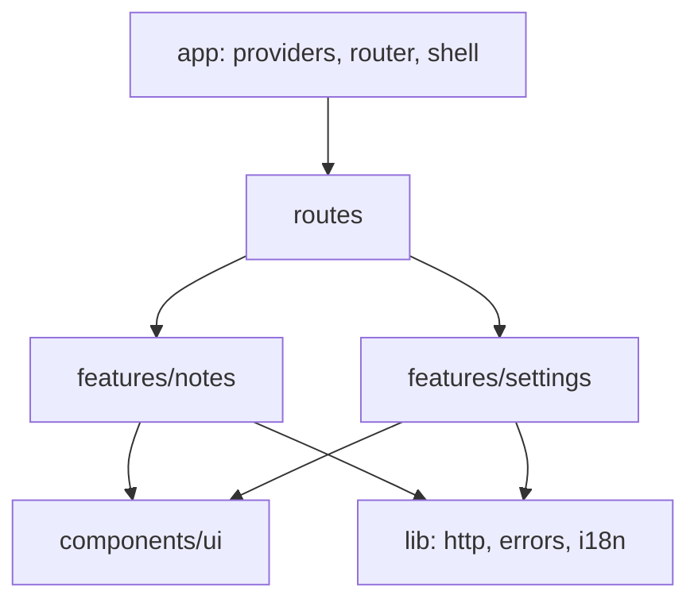

# Architecture: <App>

| Version | Status | Owner | Reviewers |
|---|---|---|---|
| 0.1 | Draft | <tech lead> | <senior frontend dev, designer, QA, security> |

## 1. Drivers
| Quality goal (rank) | Scenario | Tactic | NFR |
|---|---|---|---|
| 1. Accessibility | A keyboard-only user creates a note without a mouse | Native elements, route focus management, axe in CI | NFR-A11Y-01 |
| 2. Loading | On a mid-range phone over Fast 4G, the notes list is usable ≤ 2.5 s after opening the link | Lazy routes, prefetch in the loader, skeleton at final size | NFR-PERF-01 |

Constraints: <team, deadline, backend, identity provider, compliance>

## 2. Stack
The default stack from the react-webapp skill applies, except for:

| Concern | Choice | ADR |
|---|---|---|
| Project layout | <one package with feature folders / workspace monorepo> | ADR-0001 |
| Error reporting and RUM | <vendor> | ADR-0002 |

## 3. Structure

Layer rules: the skill's rules, plus <project-specific additions>. Enforced by: `import/no-cycle`, <restricted-import rules>, review.

## 4. State and data
| Resource | Endpoint(s) | Query key root | `staleTime` | Refetch on | Optimistic? | Persisted in browser | Conflict policy |
|---|---|---|---|---|---|---|---|
| Notes | `GET/POST/PATCH /v1/notes` | `['notes']` | 30 s | Window focus, after a write | No | No | `ETag` + `If-Match`; `412` shows a notice |

- **URL state:** <filters, sort, paging, selected item per route>
- **Shared client state:** <Context or Zustand; what lives there>
- **Browser storage:** <keys, schema version, cleared on sign-out — or "none">

## 5. API integration
- Base URLs per environment (`VITE_API_BASE_URL`)
- Auth: <cookie session / BFF / bearer token in memory>; sign-in and refresh flow; sign-out
- CSRF protection: <SameSite + token or custom header>
- Error mapping (`toAppError`)
- Pagination: <cursor / offset>
- API versioning, and compatibility with the previous frontend release
- After a deploy: chunk-load recovery; "new version available" <yes/no>

## 6. Routing
| Path | Layout | Auth | Lazy | Error boundary | FRs |
|---|---|---|---|---|---|
| `/` | Shell | Signed in | Yes | Root | FR-001 |
| `/notes/:noteId` | Shell + side panel ≥ 1280 px | Signed in | Yes | Notes | FR-003 |
| `/sign-in` | Public | — | Yes | Root | FR-010 |

- Navigation items per role, and the current-item rule
- Redirects for old or renamed public URLs
- Not-found and forbidden pages

## 7. Cross-cutting concerns
| Concern | Decision |
|---|---|
| Error model | `AppError` + `toAppError`; messages mapped in `lib/errors.ts` |
| Forms | React Hook Form + Zod / React 19 Actions |
| Logging and error reporting | <vendor>; release, route and request ID tags; no PII |
| Feature flags / remote config | <tool>; flags: <…> |
| i18n | <library>; locales <…>; RTL <yes/no> |
| Visual design | The skill's default design style (`reference/design-style.md`), <light / dark shell> / brand design system (ADR-<n>) |

### Visual design
- The style and theme, and the full token table (Phase 4 copies it into `index.css`)
- Tokens added or changed, with contrast ratios
- Breakpoints and what changes at each; shells used; content max widths
- Deviations from the house style, each with an ADR

## 8. Security
Level: ASVS <L1/L2>

| Asset / entry point | Threat (STRIDE) | Mitigation | ASVS | Req ID |
|---|---|---|---|---|
| Session | Information disclosure through XSS | `HttpOnly` cookie; no `dangerouslySetInnerHTML`; strict CSP | V3, V5, V14 | NFR-SEC-01 |
| `returnTo` parameter | Spoofing through an open redirect | Accept same-origin relative paths only | V5 | NFR-SEC-01 |
| Note form | Tampering through CSRF | `SameSite=Lax` + CSRF header checked by the backend | V4 | NFR-SEC-01 |

**CSP:** `default-src 'self'; script-src 'self'; connect-src 'self' <api> <error reporter>; img-src 'self' data:; style-src 'self'; font-src 'self'; frame-ancestors 'none'; base-uri 'self'; form-action 'self'; object-src 'none'`

## 9. Observability
- Error reporting; source maps uploaded privately by CI
- Real-user Web Vitals by route and release
- Analytics: the tracking plan (<link>) and consent
- Release dashboard
- Alert owners

## 10. Build, CI/CD and release
- Environments: local, preview per PR, staging, production
- Hosting: <host>; SPA fallback; caching (`index.html` no-cache, `/assets/*` immutable); headers
- CI stages
- Versioning scheme (`v<semver>` tags) and how a release is promoted
- Rollback: <instant rollback at the host / redeploy the previous tag>

## 11. Test strategy
A summary, with a link to [test-plan.md](test-plan.md): test levels, browser and viewport matrix, environments.

## 12. Risks and technical debt
| ID | Risk or debt | Impact | Mitigation | Owner |
|---|---|---|---|---|
